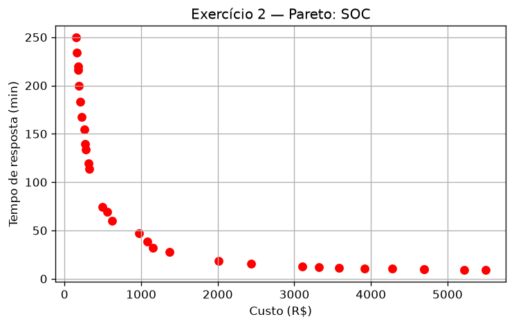
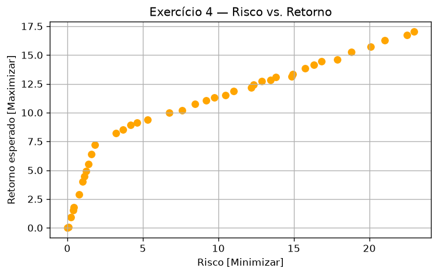
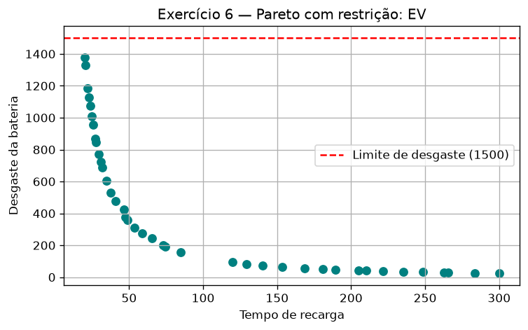
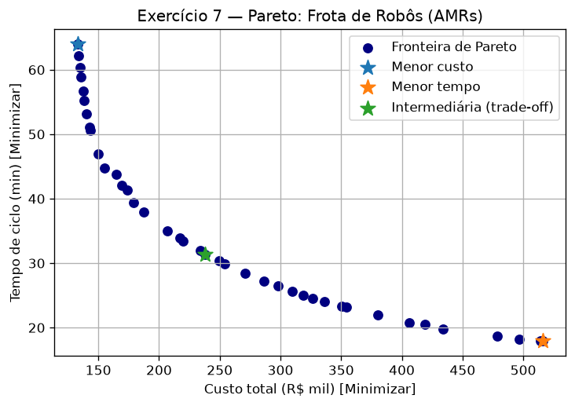

# Resultados — AULA 12 (Otimização Multiobjetivo e NSGA-II)

Todos os exercícios foram executados com `pymoo` 0.6.2. Os scripts estão na pasta `AULA_12` (`ex1_cloud.py` ... `ex6_ev.py` e `frota_robos_problem.py`), e os gráficos foram salvos como PNG.

## Exercício 1 — Compra de Servidores Cloud

Fronteira de Pareto com 1 variável (vCPUs) e 2 objetivos opostos: mais vCPUs reduzem a latência, mas aumentam o custo. Todas as 20 soluções são não dominadas, e cada ponto é um trade-off diferente.

Saída no console (`python ex1_cloud.py`):
```
Soluções na fronteira: 20
Custo: 15.0 a 480.0 R$ | Latência: 9.38 a 300.00 ms
vCPUs: 1.00 a 32.00
```


## Exercício 2 — Triagem de Incidentes SOC

TODOs: 2 variáveis (analistas 1–50, regimento 1–10), 2 objetivos (custo = 100·analistas + 50·regimento; tempo = 200/analistas + 50/regimento), NSGA2 com pop_size=30 e 40 gerações. A fronteira vai de uma equipe mínima (barata e lenta) até a equipe máxima (cara e rápida).

Saída no console (`python ex2_soc.py`):
```
Soluções na fronteira: 30
analistas=1.01 regimento=1.01 -> custo=R$ 151.6 | tempo=247.16 min
analistas=6.52 regimento=9.17 -> custo=R$ 1110.7 | tempo=36.11 min
analistas=49.99 regimento=10.00 -> custo=R$ 5499.1 | tempo=9.00 min
```


## Exercício 3 — Logística de Drones

Otimização com 3 objetivos (tempo, custo e CO2). A fronteira é uma superfície 3D, em que melhorar um objetivo piora pelo menos outro.

Saída no console (`python ex3_drones.py`):
```
Soluções na fronteira: 40
Mínimos  (tempo, custo, CO2): [12.5 60.   3. ]
Máximos  (tempo, custo, CO2): [100.   889.96 119.97]
```


## Exercício 4 — Seleção de Portfólio de Investimentos

TODOs: retorno negativo = −(rf·0,08 + ações·0,18) para maximizar o retorno, e risco = rf·0,02 + ações·0,25. O enunciado cita uma restrição de investimento sem detalhá-la, então usei rf + ações ≤ 100 (`g = rf + acoes − 100 ≤ 0`, sem alavancagem). No gráfico o sinal do retorno foi revertido. Quanto mais retorno, mais risco.

Saída no console (`python ex4_portfolio.py`):
```
Soluções na fronteira: 40
RF=0.0% Ações=0.0% -> risco=0.00 | retorno=0.00
RF=54.1% Ações=44.7% -> risco=12.27 | retorno=12.38
RF=3.2% Ações=96.6% -> risco=24.22 | retorno=17.65
```


## Exercício 5 — Trade-off de Modelos de Machine Learning

Erro de predição versus latência de inferência: modelos maiores erram menos, mas respondem mais devagar.

Saída no console (`python ex5_ml.py`):
```
Soluções na fronteira: 30
profundidade=30.0 árvores=199.9 -> erro=0.0072 | latência=105.95 ms
profundidade=25.3 árvores=25.7 -> erro=0.0140 | latência=17.88 ms
profundidade=1.0 árvores=10.0 -> erro=0.4963 | latência=5.20 ms
```


## Exercício 6 — Desafio Integrado com Restrições

TODOs: `n_ieq_constr=1`, `g1 = f2 − 1500` e `out["G"] = [g1]`, com impressão apenas das soluções viáveis (CV ≤ 0). Todas as soluções finais respeitam o limite de desgaste de 1500. A solução mais rápida (150 kW, 15 °C) tem desgaste de ≈1378, abaixo do limite.

Saída no console (`python ex6_ev.py`):
```
Soluções viáveis: 40
tempo_recarga(min) | desgaste
             20.00 |  1377.85
             20.34 |  1343.57
             20.73 |  1305.99
             21.06 |  1275.45
             21.58 |  1229.34
             21.96 |  1197.92
             22.83 |  1130.02
             23.31 |  1095.10
             24.22 |  1033.71
             25.13 |   981.15
             25.58 |   955.58
             27.11 |   876.48
             28.40 |   815.45
             29.82 |   756.88
             31.85 |   685.99
             33.87 |   625.37
             34.78 |   600.96
             37.02 |   547.74
             38.38 |   518.75
             44.97 |   408.61
             49.67 |   352.08
             57.50 |   315.84
             61.17 |   257.56
             67.36 |   222.90
             85.91 |   154.77
            100.00 |   123.23
            109.75 |   111.72
            123.91 |    89.35
            135.44 |    78.18
            161.81 |    59.88
            165.97 |    57.64
            177.11 |    52.29
            188.96 |    47.45
            194.55 |    45.42
            206.54 |    41.52
            217.23 |    38.50
            232.84 |    34.69
            245.27 |    32.18
            271.08 |    27.61
            300.00 |    23.72
```


## Exercício 7 — Dimensionamento de Frota de Robôs de Logística

Classe `FrotaRobosProblem` em `frota_robos_problem.py`, com custo `25·x1 + 8·x2²`, tempo `120/x1 + 40/x2` e restrição `g1 = x1·x2^1,5 − 120 ≤ 0`. NSGA-II com 40 indivíduos e 60 gerações. A solução intermediária é a mais próxima do ponto ideal, com objetivos normalizados. Na solução de menor tempo a restrição de consumo fica quase ativa (119,9 ≤ 120).

Saída no console (`python frota_robos_problem.py`):
```
Soluções viáveis na fronteira: 40
Menor custo: robôs=5.00 vel=1.00 m/s -> custo=R$ 133.01 mil | tempo=63.97 min | consumo=5.0
Menor tempo: robôs=15.60 vel=3.90 m/s -> custo=R$ 511.29 mil | tempo=17.96 min | consumo=119.9
Intermediária (trade-off): robôs=6.57 vel=2.57 m/s -> custo=R$ 217.15 mil | tempo=33.82 min | consumo=27.1
Gráfico salvo em ex7_pareto_frota.png
```

