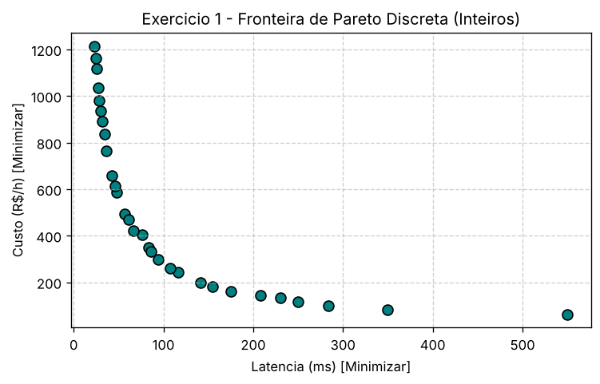
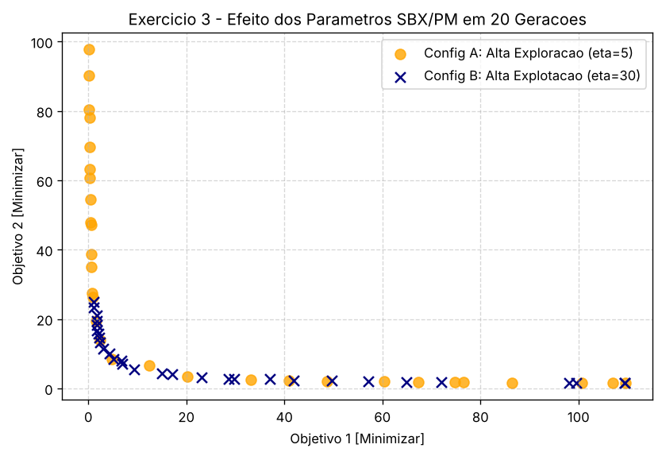
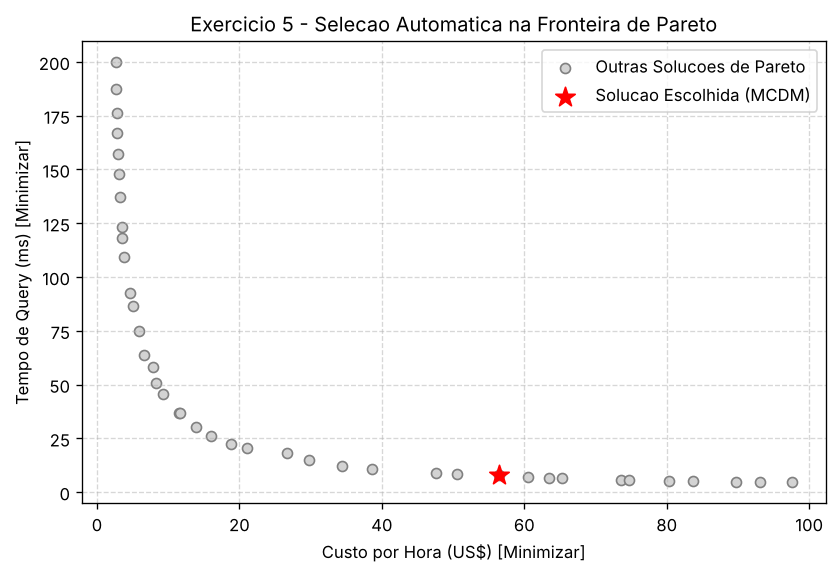

# Resultados — AULA 13 (Sprint 2 da AC-4: Operadores Evolucionários)

Todos os scripts (`aula13_lab01.py` a `aula13_lab06.py`) executaram sem erros com `pymoo` 0.6.2. Os gráficos foram salvos como PNG na mesma pasta.

## a) Diferença prática entre variáveis contínuas e inteiras (Exercício 1)

O problema do SOC foi resolvido de duas formas, com a mesma seed e as mesmas 40 gerações:

- **Com `IntegerRandomSampling` + `RoundingRepair`:** todas as soluções têm valores inteiros (por exemplo, 3 pods e 1 analista). São configurações que podem ser implantadas, e a fronteira de Pareto é discreta.
- **Com os operadores contínuos padrão:** o NSGA-II devolve valores fracionados, como 3,7868 pods e 1,3561 analistas, que não fazem sentido para servidores e pessoas.

A variável `vtype=int` na classe do problema só informa o tipo. Quem garante o resultado inteiro é o amostrador inteiro junto com o `RoundingRepair`, que arredonda os filhos gerados pelo SBX e pelo PM.

```
Amostra de 5 solucoes inteiras encontradas (Pods, Analistas):
Pods: 30 | Analistas: 15 => Latencia:  23.33ms | Custo: R$ 1215.00
Pods:  1 | Analistas:  1 => Latencia: 550.00ms | Custo: R$  63.00
Pods:  2 | Analistas:  1 => Latencia: 350.00ms | Custo: R$  81.00
Pods:  3 | Analistas:  1 => Latencia: 283.33ms | Custo: R$  99.00
Pods:  4 | Analistas:  1 => Latencia: 250.00ms | Custo: R$ 117.00

Comparacao: operadores continuos padrao (sem IntegerRandomSampling/RoundingRepair)
Pods:  29.9809 | Analistas:  14.9979
Pods:   1.0020 | Analistas:   1.0010
Pods:   3.7868 | Analistas:   1.3561
Pods:   1.3993 | Analistas:   1.0287
Pods:   3.4081 | Analistas:   1.0287
Todas inteiras (continuo)? False
Todas inteiras (com RoundingRepair)? True
Solucoes distintas na fronteira: continuo=30 | inteiro=30
```


## Exercício 2 — Cluster Kubernetes (TODOs preenchidos)

Tempo = 600/réplicas + 200/nodes, custo = réplicas·12 + nodes·85. NSGA-II com 25 indivíduos, operadores inteiros, 35 gerações e seed=10.

```
Solucoes na fronteira: 25
Replicas | Nodes | Tempo (ms) | Custo (USD/mes)
       2 |     1 |     500.00 |   109.00
       3 |     1 |     400.00 |   121.00
       4 |     1 |     350.00 |   133.00
       5 |     1 |     320.00 |   145.00
       6 |     1 |     300.00 |   157.00
       8 |     1 |     275.00 |   181.00
       4 |     2 |     250.00 |   218.00
       5 |     2 |     220.00 |   230.00
       7 |     2 |     185.71 |   254.00
      10 |     2 |     160.00 |   290.00
      13 |     2 |     146.15 |   326.00
      18 |     2 |     133.33 |   386.00
      13 |     3 |     112.82 |   411.00
      16 |     3 |     104.17 |   447.00
      11 |     5 |      94.55 |   557.00
      13 |     5 |      86.15 |   581.00
      16 |     5 |      77.50 |   617.00
      20 |     5 |      70.00 |   665.00
      20 |     6 |      63.33 |   750.00
      32 |     5 |      58.75 |   809.00
      39 |     5 |      55.38 |   893.00
      33 |     8 |      43.18 |  1076.00
      39 |     9 |      37.61 |  1233.00
      40 |    11 |      33.18 |  1415.00
      40 |    12 |      31.67 |  1500.00
```

## Exercício 3 — Exploração vs. Explotação

Na Config A (eta=5, mutação 0,5), os filhos ficam longe dos pais e a busca se espalha mais: o objetivo 2 chega até 97,71. Na Config B (eta=30, mutação 0,05), os filhos ficam perto dos pais e a busca converge mais rápido para a região boa: o objetivo 2 chega só até 24,88.

```
Config A (eta=5): 30 solucoes | f1 0.14..109.67 | f2 1.50..97.71
Config B (eta=30): 30 solucoes | f1 1.10..109.38 | f2 1.50..24.88
```


## b) Hipervolume (Exercício 4)

Ponto de referência: (400, 600).

| Gerações | Hipervolume |
|---|---|
| 10 | 226626.7048 |
| 80 | 226715.9378 |

O ganho foi de 89,23 (0,04%). Como o HV já era alto com 10 gerações, as 80 gerações trazem apenas um refinamento. Quanto maior o HV, melhor a fronteira.

```
Hipervolume (10 geracoes): 226626.7047731528
Hipervolume (80 geracoes): 226715.9377825793
Ganho do HV: 89.23 (0.04%)
Solucoes na fronteira: 10 gen = 40 | 80 gen = 40
```

## Exercício 5 — MCDM com PseudoWeights

```
Decisao Recomendada (Pesos 30% Custo / 70% Performance):
-> Configuracao: 76.6 GB RAM | 2755 IOPS
-> Resultado:    US$ 56.52/h | Tempo de Query: 8.06 ms
```


## c) Escala hospitalar recomendada pelo MCDM (Exercício 6)

Pesos: 40% custo e 60% tempo de espera. Restrição de SLA: `g1 = f2_espera − 25 ≤ 0`.

| Médicos | Enfermeiros | Custo do plantão | Tempo de espera |
|---|---|---|---|
| **17** | **32** | **R$ 34.800,00** | **18,09 min** |

A solução respeita a restrição f2_espera ≤ 25,0 (18,09 ≤ 25,0), e o script confirma isso com um `assert`.

```
Solucoes viaveis na fronteira: 40 de 40
Medicos | Enfermeiros | Custo (R$) | Espera (min)
     12 |          24 |   25200.00 |    25.00
     13 |          22 |   25500.00 |    24.76
     12 |          25 |   25650.00 |    24.60
     13 |          23 |   25950.00 |    24.28
     12 |          26 |   26100.00 |    24.23
     13 |          24 |   26400.00 |    23.85
     14 |          22 |   26700.00 |    23.77
     13 |          25 |   26850.00 |    23.45
     14 |          23 |   27150.00 |    23.29
     13 |          26 |   27300.00 |    23.08
     14 |          24 |   27600.00 |    22.86
     13 |          27 |   27750.00 |    22.74
     14 |          26 |   28500.00 |    22.09
     14 |          27 |   28950.00 |    21.75
     15 |          25 |   29250.00 |    21.60
     14 |          28 |   29400.00 |    21.43
     14 |          29 |   29850.00 |    21.13
     15 |          28 |   30600.00 |    20.57
     16 |          26 |   30900.00 |    20.48
     15 |          29 |   31050.00 |    20.28
     15 |          30 |   31500.00 |    20.00
     15 |          31 |   31950.00 |    19.74
     16 |          30 |   32700.00 |    19.25
     17 |          28 |   33000.00 |    19.16
     15 |          34 |   33300.00 |    19.06
     17 |          32 |   34800.00 |    18.09
     17 |          33 |   35250.00 |    17.86
     17 |          34 |   35700.00 |    17.65
     18 |          33 |   36450.00 |    17.27
     19 |          32 |   37200.00 |    16.97
     19 |          33 |   37650.00 |    16.75
     20 |          32 |   38400.00 |    16.50
     20 |          33 |   38850.00 |    16.27
     20 |          34 |   39300.00 |    16.06
     20 |          35 |   39750.00 |    15.86
     20 |          36 |   40200.00 |    15.67
     20 |          37 |   40650.00 |    15.49
     20 |          38 |   41100.00 |    15.32
     20 |          39 |   41550.00 |    15.15
     20 |          40 |   42000.00 |    15.00

Escala recomendada (pesos 40% Custo / 60% Tempo de Espera):
-> Medicos: 17 | Enfermeiros: 32
-> Custo do plantao: R$ 34800.00 | Tempo de espera: 18.09 min
Restricao f2_espera <= 25.0 respeitada: 18.09 <= 25.0
```
